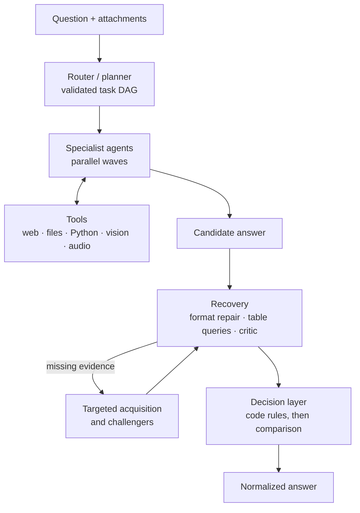

# GAIA Agent Harness

A modular Python harness for tool-using LLM agents, evaluated on the 20-question
GAIA Level-1 set of the Hugging Face Agents Course. It combines context
compression, DAG planning with specialist agents, parallel tool execution,
critic-driven verification and a code-owned decision layer.

**Result:** with `gpt-4.1-mini`, exact-match accuracy rose from **11/20** (R0) to
**20/20 in three consecutive fresh runs** (R16), scored by the official grader.

> Built independently while studying the
> [agent-harness-course](https://github.com/jiminelee/agent-harness-course)
> curriculum. "Module N" in this repository refers to that course's modules.
> See [ATTRIBUTION.md](ATTRIBUTION.md) for provenance.

**Contents:** [Architecture](#architecture) · [Results](#results) ·
[Harness modules](#harness-modules) · [Repository layout](#repository-layout) ·
[Quick start](#quick-start) · [Running evaluations](#running-evaluations) ·
[Deployment](#deploy-to-hugging-face-spaces) · [Security](#security-boundary) ·
[Documentation](#documentation)

## Architecture



Design principles:

- **Code owns decisions where it can.** Table queries are written by the model,
  reviewed independently, then executed by code; an answer backed by executed
  Python outranks mental arithmetic; ties and exclusions are applied in code.
- **Evidence before confidence.** Answers must be grounded in observed tool
  output (NFKC provenance matching); an abstention can never pass verification.
- **General mechanisms, not per-question patches.** No benchmark IDs, answer
  keys or site-specific layouts appear in the runtime code.
- **Bounded everything.** Turns, replans, critic rounds, tool failures and
  model calls all have explicit limits.

## Results

| Version | Score | Main change |
|---|---:|---|
| R0 | 11/20 | Course modules composed with the GAIA adapter and tools |
| R5 | 16/20 | Chessboard read cell by cell; engine move computed in code |
| R7b | 17/20 | Deterministic table selection and arithmetic; bounded PDFs |
| R12 | 19/20, 18/20 | Historical records joined to full identities |
| R13 | 19/20, 19/20 | Observed numbered records copied by code |
| R14 | 20/20, 18/20 | Literal table rendering; reviewed, code-executed table queries |
| R15 | 20, 20, 18, 19, 19 | Degrade-not-fail census; normalized list schemas |
| **R16** | **20/20, 20/20, 20/20** | Multiscale image tiling; execution-backed decisions |

Every version is preserved as a Git tag (`stable/*`, `checkpoint/*`, and `archive/*`
for experiments that were not promoted). The 20 questions are a repeatedly used development set, so these scores do not
establish held-out generalization. Token totals exclude audio transcription.

<details>
<summary><b>Full iteration log (R0–R16): commits, tokens, rationale and feedback</b></summary>

Every full-set row is a fresh run submitted to the official scorer unless marked
as a re-score (*); targeted batches are labelled separately. Failed experiments
are retained in Git, without mixing answers across runs.

| Version / runtime commit | Score | Chat tokens | Change and reason | Feedback |
|---|---:|---:|---|---|
| R0 · Base (archived source snapshot) | 11/20 | 346,674 | Compose the basic course-module implementations with the GAIA adapter and tools, before the subsequent GAIA-focused optimization rounds. | Starting full-harness baseline: modules were present, but retrieval, routing and evidence handling still caused failures. |
| R1 · `ea7a1dd` | 14/20 | 431,574 | Replace broad replanning with targeted evidence recovery and separate format repair. | Reference checkpoint; fewer unproductive model calls. |
| R2 · `25ac623` | 12/20 | 507,325 | Add completion contracts and visual reinspection to prevent missing evidence from becoming a factual premise. | Regression: overly strict unavailable answers; nested timestamps and illegal FEN bypassed reinspection. Not promoted. |
| R3 · `64f0b01` | 13/20 | 489,813 | Fix reinspection branches and relax the unavailable-answer policy. | Execution improved, but visual recognition and semantic classification remained wrong. Still below R1; restored R1. |
| R4 · `392ad9c` | 15/20 | 413,810 | Preserve recipe phrases as exact source spans; account for every list item, research technical definitions, and apply exclusions in code. | Recipe and botanical-list targets improved; unrelated spreadsheet and historical-nationality answers regressed. Classification was not yet stable. |
| R5 · `042b2e3` | **16/20** | **350,250** | Direct grid transcription still failed, so crop and label chessboard cells, identify pieces, map coordinates in code, then call the engine. | Chess repair reproduced in targeted and full tests. Recipe remained correct; botanical classification regressed. Previous best checkpoint. |
| R6 · `c5c7ebb` | 15/20 | 348,129 | A source PDF exceeded the shared 3 MB cap. Add bounded streaming with a separate 50 MB PDF budget and retain long-document tails. | Funding repair reproduced, but actor lookup, spreadsheet membership and name formatting regressed. Not promoted; retain R5 pending broader validation. |
| R7a · `81bd708` | 14/20 | 370,173 | Move sums, entity joins and evidence references into code-owned contracts. | Spreadsheet repaired; strict entity evidence reduced coverage. Preserved as an experiment. |
| R7b · `87e0b03` | **17/20** | 370,653 | Keep deterministic table selection/arithmetic and bounded PDFs; make strict entity chains opt-in. | All three regression targets correct; the gain over R5 is the funding answer. Entity gains use the existing lookup route, not proof of the experimental chain. |
| R8a · `83ea796` | 17/20 | 390,706 | Inspect video segments individually, classify plant parts before applying rules, and enforce dated roster evidence. | Video and botanical targets repaired; historical roster remains unresolved. An unrelated webpage answer and terminal punctuation regressed. |
| R8b · `b1e5982` | **18/20*** | 390,706 | Normalize sentence punctuation on single-word answer contracts. | Re-score the same complete answer set; no new model calls or answer-set mixing. Historical roster and chemistry-page lookup remain unresolved. |
| R9 · `6086685` | **18/20** | 497,302 | Isolate optional domain policies and strategy dispatch; narrow applicability and allow dated retrospective sources. | Fresh full run preserves score. Six non-GAIA smoke tasks have correct content (5/6 exact strings). Cost increased; broad generalization is not established. |
| R10 experimental · `4585acc` | Targeted: **5/6** | 320,363 | Retrieve answer-relevant original passages, compare candidates equally, and avoid duplicate recovery requests. | Three fresh runs of two fluctuating tasks: both correct in 2/3 runs. Source selection still fails once; not a new full-set score. |
| R11 experimental · `a67e37f` | Targeted: **6/6** | 233,540 | Flag unconfirmed author identity and bound same-document navigation across loop transitions. | Both fluctuating tasks correct in all three fresh rounds; 27.1% fewer tokens than R10's final batch. Small development sample, not a full-set or stability guarantee. |
| R12 development · `c6d031a` → `8a18211` | 16 → 19 → 17 → 19 → 17/20 | See evaluation | Join historical native-language records to full identities; copy evidence spans in code, fetch unread leads and retain count/date scope. | Gains and regressions retained; search and verification remain variable. |
| R12 frozen · `4f4e27d` | **19/20, 18/20** | 363,744 / 496,625 | Preserve simple HTML table column labels; freeze runtime for two fresh full runs. | Historical target correct in both; answer formatting, list fallback and species identity caused remaining failures. |
| R12 output rendering · `b47a355` | **20/20*, 18/20*** | Same as above | Render an unambiguous requested numeric count only after reasoning finishes. | Re-score both complete frozen answer sets; no new model calls or mixed answers. First perfect score, not stable 20/20. |
| R13 development · `9159a5a` → `579275d` | 16 → 18/20 | 581,933 / 696,152 | Preserve valid classification fields, short-circuit exclusions, separate age from species, and aggregate explicit verification checks in code. | Targets improved; historical quotation fidelity and missing long-page passages still failed. |
| R13 frozen · `c1e4e71` | **19/20, 19/20** | 517,432 / 559,916 | Copy observed numbered records and retain long-document tails/query passages. | Two fresh full runs: historical roster failed once; Olympic minimum/tie selection failed once. Video, botanical list, numeric formatting and funding passed both. Not stable 20/20. |
| R14 · structured tables + reviewed table queries + decision layer | **20/20, 18/20** | 631,065 / 448,923 | Render tables as literal rows; NFKC provenance; layout-agnostic record grounding; declarative table queries executed by code after independent spec review; best-supported selection instead of abstention; prose candidates reduced to literal values. | Fresh cloud runs (YouTube raw inputs reused). Both R13 failures fixed in all six R14 runs; remaining variance: visual species recognition and a compound given name. Not stable 20/20. |
| R15 · degrade-not-fail, schema normalization | **20/20, 20/20**, 18, 19, 19 | 429,657–577,925 | Per-group census degradation, broader abstention detection, normalized list-contract flags, one given name for "first name" requests. Perception routing and census adjudication were measured and rejected. | All non-video questions correct in both r15b runs; the video species count fails in about half of runs because of visual recognition. Not stable 20/20. |
| R16 · multiscale perception + execution-backed decisions | **20/20, 20/20, 20/20** | 575,555 / 614,890 / 595,394 | Full image plus overlapping enlarged tiles for vision; coarse-to-fine video census; requested-category counting; executed computation outranks mental reasoning; abstentions cannot pass verification; identity-gap lead ranking; 404 pages fall back to the parent's real links; grounding judged at production time; transcription consensus; a critic FAIL naming an alternative becomes a challenger. | Three consecutive fresh cloud runs (YouTube raw inputs reused), search failure rate 37% / 9% / 5%. The video species count, unstable in R14/R15, was correct in all three. |

*R8b and R12's starred scores apply only final formatting to existing answer
sets; no new model calls were made. Historical runs used different prompts and
cache states, so their scores are not controlled architecture comparisons.

</details>

Diagnoses, rejected approaches and per-round metrics are in
[EVALUATION.md](EVALUATION.md) and [FAILURE_ANALYSIS.md](FAILURE_ANALYSIS.md).

## Harness modules

Module numbers follow the [agent-harness-course](https://github.com/jiminelee/agent-harness-course)
curriculum, which this harness was built against as a learning roadmap.

| Module | Implementation |
|---|---|
| 0–3 · Agent loop | Reusable `BaselineAgent` tool loop with a per-task tool registry and bounded turns. |
| 4 · Memory | Bounded context compression that keeps the task and recent messages verbatim and summarizes only complete older tool transactions. |
| 5/10 · Planning and multi-agent | One request routes and plans a task DAG (validated IDs, specialists, acyclic dependencies). Ready nodes run in bounded waves; each specialist has a fresh history and a restricted tool set. |
| 6 · Recovery and verification | Independent JSON-mode critic; format repair separated from factual verification; targeted evidence acquisition in at most three tool-loop turns. |
| 7 · Parallel tools | Read-only calls run in parallel with ordered results; unsafe and media calls stay serial. |
| 8 · Guardrails | JSON Schema validation, dangerous-tool metadata, default-deny approval callback and audit events. |
| 9 · Observability | Persistent per-task traces (latency, tokens, tool calls, errors) and a timeline viewer: `python scripts/view_trace.py PATH`. |
| 11 · Packaging and runtime | Importable package, central configuration, per-task response cache, versioned system prompts, call budget and cost estimates. |

Module 12 of the course is a production roadmap and is not claimed as
implemented. Memory, planning, recovery, replanning, parallel tools and
multi-agent routing each have an `AGENT_*_ENABLED` flag; `02f_run_all_modules.bat`
enables the full stack.

## Repository layout

```text
gaia_agent/
  agent.py              agent loop, answer recovery and candidate comparison
  orchestration.py      validated task DAG and specialist-as-tool execution
  decision.py           answer selection, separated from confidence
  verification.py       evidence-based candidate comparison
  table_queries.py      model-written, reviewed, code-executed table queries
  perception.py         multiscale image views for vision calls
  resolution.py         item-level evidence, temporal joins and visual censuses
  tools.py              web, file, transcript and guarded Python tools
  tracing.py            structured JSON traces and metrics
  ...                   config, runtime, memory, policies, workflows
scripts/                full and targeted experiments, run comparison, trace viewer
tests/                  offline unit tests (no model calls)
app.py, cli.py          Gradio app and local CLI
*.bat                   Windows workflow scripts
```

## Quick start

```powershell
py -m venv .venv
.venv\Scripts\Activate.ps1
python -m pip install -r requirements.txt -r requirements-dev.txt
$env:OPENAI_API_KEY = "your-key"
$env:HF_TOKEN = "your-read-token"   # optional, see below
```

The code deliberately does not auto-load secret files; set keys in the shell.
`HF_TOKEN` enables the attachment fallback to the gated `gaia-benchmark/GAIA`
dataset (accept its terms first).

```powershell
python cli.py ask "What is 17 * 23? Return only the number."
python cli.py random      # one random benchmark question
python cli.py all         # all 20 questions
python app.py             # Gradio UI
pytest -q                 # offline tests
```

For chess positions, set `STOCKFISH_PATH` to a Stockfish executable from the
[official distribution](https://stockfishchess.org/download/) (or place it under
`.tools/stockfish/`). Without an engine the tool falls back to Lichess cloud
evaluation.

## Running evaluations

```powershell
python scripts/run_full_experiment.py
```

Runs exactly 20 fetched questions in a new `.runs/full_TIMESTAMP` directory with
fresh tool caches, snapshots the source, and submits to the official scorer.
This consumes model tokens and writes a leaderboard submission. To compare two
runs without model calls or labels:

```powershell
python scripts/compare_runs.py .runs/full_FIRST .runs/full_SECOND
```

The official grader compares answers case-insensitively after trimming
whitespace, so the agent returns answer-only output and `normalize_answer()`
removes wrapper text and applies ordering only when the question asks for it.
Do not use leaderboard probing to choose answers for a reported run.

<details>
<summary><b>Windows workflow scripts</b></summary>

| Script | Purpose |
|---|---|
| `00_hf_login_once.bat` | Cache the Hugging Face login locally. |
| `00_save_openai_key_once.bat` | Prompt once and persist `OPENAI_API_KEY` as a user environment variable. |
| `01_test_local.bat` | Ruff and pytest, no model calls. |
| `02_run_gaia_all.bat` | Run all 20 questions and archive an experiment snapshot. |
| `02a`–`02e` | Controlled runs enabling one module at a time (baseline, memory, planning, recovery, parallel tools). |
| `02f_run_all_modules.bat` | Run with every module enabled. |
| `03_publish_space.bat` | Upload source and configuration files to the public Space. |
| `04_submit_cached_answers.bat` | Submit cached answers without rerunning the agent. |

The scripts never store or upload secrets. They use the author's
`zzzt19/gaia-baseline-agent` Space; change it before publishing or submitting.

</details>

## Deploy to Hugging Face Spaces

1. Create a public Static Space (or a Gradio Space if your account supports compute).
2. Copy the contents of this directory to the Space repository root.
3. With the free Static workflow, run and score locally; the Space only hosts the source.
4. Publish with `03_publish_space.bat`, then submit with `04_submit_cached_answers.bat`.

The leaderboard expects a public `https://huggingface.co/spaces/<user>/<space>/tree/main`
code URL. If the scoring service's `/files/{task_id}` endpoint returns 404 (seen on
2026-08-30), the client falls back to the gated GAIA dataset via `HF_TOKEN`.

## Security boundary

`run_python` rejects dangerous imports, dynamic-execution builtins, dunder access
and long programs, and runs in a child process with a timeout. This is an
educational guardrail, not a secure sandbox; do not expose the Space to arbitrary
anonymous prompts without container isolation. `fetch_url` rejects private,
loopback and link-local destinations to reduce SSRF risk.

## Documentation

- [EVALUATION.md](EVALUATION.md): per-round experiments, metrics and limitations
- [FAILURE_ANALYSIS.md](FAILURE_ANALYSIS.md): per-question failure ledger
- [CONTRACTS.md](CONTRACTS.md): code-owned task contracts
- [ATTRIBUTION.md](ATTRIBUTION.md): provenance, data and dependency licenses

Credentials, benchmark data, raw traces and downloaded engines are excluded from Git.
